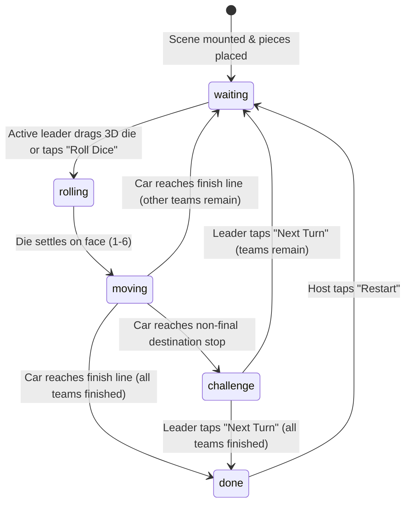

# GameScreen Gameplay & Improvement Roadmap

> Comprehensive analysis of the core gameplay loop inside `GameScreen` in **TipsyTraveller**, detailing the current state machine, 3D spatial presentation, multiplayer flow, observed limitations, and actionable improvement proposals.

---

## Table of Contents

1. [Executive Summary](#1-executive-summary)
2. [Current GameScreen Architecture](#2-current-gamescreen-architecture)
3. [The Gameplay Loop (Step-by-Step)](#3-the-gameplay-loop-step-by-step)
   - [Phase 1: Orientation & Board Initialization](#phase-1-orientation--board-initialization)
   - [Phase 2: Turn Start (`waiting`)](#phase-2-turn-start-waiting)
   - [Phase 3: Rolling the Die (`rolling`)](#phase-3-rolling-the-die-rolling)
   - [Phase 4: Driving & Spatial Navigation (`moving`)](#phase-4-driving--spatial-navigation-moving)
   - [Phase 5: Destination Stop & Challenge Popup (`challenge`)](#phase-5-destination-stop--challenge-popup-challenge)
   - [Phase 6: Turn Advancement & Skip Logic](#phase-6-turn-advancement--skip-logic)
   - [Phase 7: Tour Completion & Restart (`done`)](#phase-7-tour-completion--restart-done)
4. [Multiplayer Synchronization & Spectator Model](#4-multiplayer-synchronization--spectator-model)
5. [Current Limitations & Gameplay Gaps](#5-current-limitations--gameplay-gaps)
6. [Improvement Roadmap](#6-improvement-roadmap)
   - [A. Win Conditions, Podiums & Endgame Climax](#a-win-conditions-podiums--endgame-climax)
   - [B. Interactive Challenge Resolution & Scoring](#b-interactive-challenge-resolution--scoring)
   - [C. Dynamic Board Events & Tile Mechanics](#c-dynamic-board-events--tile-mechanics)
   - [D. Spectator Agency & Party Interactivity](#d-spectator-agency--party-interactivity)
   - [E. Audio, Haptics & Sensory Juice](#e-audio-haptics--sensory-juice)
   - [F. Camera Exploration & Race HUD](#f-camera-exploration--race-hud)
   - [G. Connecting Inactive Settings & Career Statistics](#g-connecting-inactive-settings--career-statistics)
7. [Priority Implementation Matrix](#7-priority-implementation-matrix)

---

## 1. Executive Summary

`GameScreen` is the central operational hub of TipsyTraveller. While the preceding screens (`CreateGame`, `HostName`, `JoinGame`, `Lobby`, `CharacterSelection`) establish room settings, team rosters, and vehicle choices, `GameScreen` executes the active party board game.

It unites two distinct rendering engines:
- **WebGL (Expo GL / React Three Fiber / Three.js)** for the 3D relief map, curved highway paths, country destination pins, animated vehicles, and interactive physics-based dice.
- **Native React Native Views** layered on top for the Heads-Up Display (HUD), TourControl turn controls, and ticket-style Country Challenge popups.

While the foundation is technically sound with impressive visual elements (e.g. 3D physics dice, mid-air vehicle kickflips, and perforated ticket animations), the gameplay mechanics remain strictly linear with no scoring, no win/podium recognition, disconnected settings (difficulty and drinking modes have zero effect), silent audio, and passive spectators. This document provides a thorough audit of the existing experience and a blueprint for elevating it into a premier mobile party game.

---

## 2. Current GameScreen Architecture

The screen layout stacks interactive React Native controls directly over the 3D scene:

```text
GameScreen [Root View: #223144]
├── GameScene [React Three Fiber Canvas - Full Screen]
│   ├── Directional & Ambient Lighting
│   ├── MapPlane (Relief Map Geometry & Texture)
│   ├── DottedRouteLine (Catmull-Rom Spline with Dynamic Dash & Trim)
│   ├── CountryMarkers (3D Location Pins with Animated Rings)
│   ├── GamePieces (Team Vehicle GLB Models, Rotations, Kickflips)
│   ├── BoardDice (3D Throw/Bounce Physics & Face Snapping)
│   └── CameraController (Cinematic Follow & Static Overview Modes)
│
├── GameHud [Absolute Overlay - Top Left]
│   ├── Active Team Label
│   ├── Route Segment (From Stop → To Stop)
│   └── Progress Subtitle (Leg Count / Roll Info)
│
├── TourControl [Absolute Overlay - Top Right]
│   ├── Active Team Heading
│   ├── Last Roll Value
│   └── Action Button (Roll Dice / Moving / Challenge / Restart)
│
├── ChallengePopup [Absolute Modal Overlay - Center]
│   ├── 3D Flying Postcard Transition
│   ├── Ticket Stub (Landmark Vector Silhouette & Perforation)
│   ├── Country Flag Stripes & City Details
│   ├── Challenge Prompt, Timer Tag & Penalty Box
│   └── Tear-Off Complete / Next Turn Button
│
└── CountryStopPlacementForm [Web Dev Portal Only]
```

### Component & File Reference
- Controller: [GameScreen.js](file:///Users/nielspeters/Documents/TipsyTraveller/app/GameScreen/GameScreen.js)
- 3D Scene: [GameScene.js](file:///Users/nielspeters/Documents/TipsyTraveller/app/GameScreen/components/GameScene.js)
- Physics Dice: [BoardDice.js](file:///Users/nielspeters/Documents/TipsyTraveller/app/GameScreen/components/BoardDice.js)
- Vehicle Management: [GamePieces.js](file:///Users/nielspeters/Documents/TipsyTraveller/app/GameScreen/components/GamePieces.js) & [GamePiece.js](file:///Users/nielspeters/Documents/TipsyTraveller/app/GameScreen/components/GamePiece.js)
- Challenge Presentation: [ChallengePopup.js](file:///Users/nielspeters/Documents/TipsyTraveller/app/GameScreen/components/ChallengePopup.js)
- HUD & Controls: [GameHud.js](file:///Users/nielspeters/Documents/TipsyTraveller/app/GameScreen/components/GameHud.js) & [TourControl.js](file:///Users/nielspeters/Documents/TipsyTraveller/app/GameScreen/components/TourControl.js)
- Multiplayer Synchronization: [useMultiplayerGame.js](file:///Users/nielspeters/Documents/TipsyTraveller/app/GameScreen/hooks/useMultiplayerGame.js)

---

## 3. The Gameplay Loop (Step-by-Step)



### Phase 1: Orientation & Board Initialization
1. **Landscape Lock**: The screen locks device orientation to landscape upon mount (`ScreenOrientation.lockAsync`).
2. **Route Generation**: Reads the duration-sized route snapshot from `gameData.routeStops` (or falls back to default catalogue: Paris → Madrid → Lisbon → Sevilla → Rome → Berlin → Brussels). A 3D Catmull-Rom spline curve is computed across all stop coordinates.
3. **Team Assembly**: Spawns 2 or 3 team vehicles based on player count (`1-4`, `5-8`, or `9-12`). Model selections (Rally Truck, Party Van, Moon Buggy, Disco Cruiser) are resolved from `gameData.teamModels`.
4. **State Restoration**: If re-entering an in-progress game via 4-digit PIN, Firebase transactional state restores active team, piece positions, and current phase.

### Phase 2: Turn Start (`waiting`)
- The active team is highlighted in both `GameHud` (top-left) and `TourControl` (top-right).
- In a multiplayer room:
  - If the device belongs to the **active team's leader**, the 3D die is unlocked and the "Roll Dice" button is enabled.
  - If the device belongs to a non-leader or an opposing team member, controls are disabled with the label `"Waiting for [Team]..."`.
- The 3D camera rests in the global overview position (`DONE_POS`), viewing the entire European map.

### Phase 3: Rolling the Die (`rolling`)
Players have two methods to roll:
1. **Interactive 3D Die**:
   - The die floats idly with a pulsing "THROW ME" voxel label at the bottom of the screen.
   - The player touches and drags the die anywhere in the throw zone, accumulating a throw impulse.
   - Upon release, the die enters simulated physics: airborne flight, gravity, table boundary collisions, angular velocity, and floor bounce restitution.
   - Once kinetic energy drops below threshold, the die snaps to the nearest facing pip (1–6).
   - The die zooms into screen center focus for `DICE_RESULT_DURATION` (~1.4s) before exiting.
2. **HUD Action Button**:
   - Tapping "Roll Dice" in `TourControl` bypasses manual throwing, immediately generating a random roll (1–6).

### Phase 4: Driving & Spatial Navigation (`moving`)
- **Path Reveal**: The dotted road line illuminates ahead of the vehicle from the start stop up to `targetLeg = min(currentLeg + roll, finalStopIndex)`.
- **Camera Follow**: Camera switches from static overview to smooth 3D tracking, following the active vehicle from behind and above.
- **Driving Dynamics**:
  - The vehicle drives along the curve at `1.95 units/second`.
  - Wheel bounce (`Math.sin(time * 9.5) * 0.01`) and tangent curve banking are applied.
- **Mid-Air Kickflip Pass**:
  - If an opposing team's vehicle is parked at an intermediate stop along the path, the moving vehicle executes an aerial leap (`height = 0.72 units`) with a full 360° barrel roll / kickflip directly over the parked car.
- **Multi-Car Parking Slots**:
  - Cars parked at the same stop do not z-fight; they smoothly occupy lateral parking offsets (Center, Left, Right).
- As each intermediate stop is crossed, `GameHud` decrements the remaining stops counter in real-time.

### Phase 5: Destination Stop & Challenge Popup (`challenge`)
- Once the vehicle reaches its destination:
  - If the destination is an **intermediate stop**, `ChallengePopup` opens.
  - If the destination is the **final stop**, the team is marked `isDone: true`, skipping the challenge.
- **Ticket Presentation**:
  - A postcard flies from the 3D map pin into screen center with a 3D perspective flip (`rotateY: 180°`).
  - Displays country flag, destination city, custom pixel-art landmark silhouette (e.g., Eiffel Tower, Colosseum, Brandenburg Gate), mission code, challenge prompt, and failure penalty.
- **Resolution**:
  - The active team leader taps `"Next Turn"`.
  - The ticket stub undergoes an animated perforated tear (`tearing` sequence).
  - The turn transitions to the next unfinished team.

### Phase 6: Turn Advancement & Skip Logic
- `getNextActiveTeamIndex` scans forward cyclically across the roster.
- Any team that has already reached the final stop (`isDone === true`) is skipped automatically.
- Play continues until no unfinished teams remain.

### Phase 7: Tour Completion & Restart (`done`)
- When the last team crosses the finish line:
  - Phase switches to `done`.
  - `GameHud` displays `"Tour complete!"`.
  - `TourControl` displays `"Game Over"` and a `"Restart"` button.
  - In multiplayer, only the room host can trigger restart. Restart resets all team progress records to stop `0` via a transactional Firebase write.

---

## 4. Multiplayer Synchronization & Spectator Model

TipsyTraveller uses a server-authoritative state model over Firebase Realtime Database:
- **Authority**: The host and active team leader execute transactional updates at `games/{gameID}/gameplay`.
- **Spectator Experience**: Non-active players observe state changes streamed via `onValue`. Roll outcomes, car movements, and challenge popup flips animate synchronously on all devices.
- **Disconnect Resilience**: Reconnecting devices query the room PIN, matching their AsyncStorage `deviceID` to restore their team leader or host status seamlessly.

---

## 5. Current Limitations & Gameplay Gaps

Despite the strong presentation, a detailed audit reveals several critical gameplay gaps:

| Area | Current Behavior | Gameplay Impact |
|---|---|---|
| **Endgame & Win Condition** | Shows static `"Tour complete!"`. No winner is declared. | The race has no climax. The team that finished first gets zero recognition, celebration, or podium standing. |
| **Difficulty Setting** | "Easy", "Medium", "Lethal" chosen in setup is stored in Firebase but **never read** by `GameScreen`. | Setup choices feel meaningless to players. Challenges and penalties remain identical across all difficulties. |
| **Drinking Modes** | `SettingsScreen` defines "Classic Tipsy" (alcoholic) vs "Sips & Dares" (non-alcoholic), but `ChallengePopup` hardcodes beer sips. | Non-drinkers and designated drivers face awkward alcoholic prompts despite selecting non-drinking mode. |
| **Challenge Outcome & Scoring** | Only a single `"Next Turn"` button exists. The app never records whether a challenge was passed or failed. | No honor system, no penalty tracking, and career statistics (`challengesCompleted`, `sipsLogged`) in `AccountScreen` are never updated. |
| **Challenge Timers** | Many challenges mention seconds ("20 seconds", "5-second performance"), but show only a static chip. | Players must manually count out loud; there is no live countdown, visual urgency, or buzzer sound. |
| **Audio & Haptics** | Entirely silent. Zero sound effects or vibrations. | Rolling the die, mid-air kickflips, and tearing challenge tickets lack tactile and sensory impact. |
| **Spectator Engagement** | Non-active players see `"Watching - Waiting for Team X"` with no interactive controls. | In 8-12 player games, downtime between turns can be long and boring for waiting teams. |
| **Board Dynamics** | Pure linear movement along a single path. No special tiles, forks, shortcuts, or hazards. | Every roll feels identical. Landing on an opposing team's tile triggers a visual kickflip but zero gameplay consequences. |
| **Camera Freedom** | Camera is locked to either automated follow or fixed top-down overview. | Players cannot pan, tilt, or pinch-zoom to explore upcoming cities or landmarks while waiting. |

---

## 6. Improvement Roadmap

The following proposals are designed to elevate `GameScreen` into a vibrant, competitive, and memorable party experience.

### A. Win Conditions, Podiums & Endgame Climax
- **Race Standings Tracking**: Record finishing order (`1st`, `2nd`, `3rd` Place) as each team crosses the final destination stop.
- **Victory Podium Overlay**:
  - When all teams finish, replace the static `"Tour complete!"` banner with an animated 3D/2D podium celebration.
  - Display the winning team's vehicle on the top pedestal with confetti particle effects.
  - Present tour statistics: Total sips taken, challenges conquered, highest roll, and "Party MVP" team award.
- **Early Finish Perks**:
  - When a team finishes early while other teams are still racing, give them "Spectator Heckling" powers or allow them to assign penalties to racers still on the road.

### B. Interactive Challenge Resolution & Scoring
- **Pass / Fail Buttons**:
  - Replace the single `"Next Turn"` button with two distinct choices:
    - **"NAILED IT! (Pass)"**: Team succeeded; no penalty. Increments team score and career `challengesCompleted`.
    - **"TOOK THE SIP (Fail)"**: Team failed; displays penalty animation and increments `sipsLogged`.
- **Audience Voting Mode**:
  - In multiplayer, let opposing teams vote on their phones: `👍 PASS` or `👎 DRINK!`. Majority rules within 10 seconds.
- **Active Challenge Countdown Timer**:
  - When a challenge specifies a duration (or when "Speed Run" timer is enabled in Settings), show a prominent 30s/20s animated circular countdown with color shift (Green → Yellow → Red).
- **Drinking Mode Adaptation**:
  - Honor the user's `drinkMode` setting from `userSettings.js`:
    - **Classic Tipsy**: "Take 2 sips", "Down your drink".
    - **Sips & Dares (Mocktail/Party)**: "Take 2 sips of water/soda", "Do 10 jumping jacks", "Switch seats with the player on your left".
- **Difficulty Scaling**:
  - **Easy**: Forgiving challenges, 1 sip penalties, extra timer seconds.
  - **Medium**: Standard rules and 2 sip penalties.
  - **Lethal**: Double penalties, strict 15s timers, and "Table Drink" rules (entire team drinks if leader fails).

### C. Dynamic Board Events & Tile Mechanics
Transform the board from a simple distance track into an exciting board game with special tile types:

```text
[Stop 0: Start] ➔ [Stop 1: Standard Challenge] ➔ [Stop 2: Detour Fork] ➔ [Stop 3: Speed Trap] ➔ [Stop 4: Nitro Boost] ➔ [Stop 5: Head-to-Head Duel] ➔ [Stop 6: Finish]
```

1. **Head-to-Head Showdown (Bump/Collision Rule)**:
   - When a vehicle lands on a stop already occupied by another team, trigger a **"Border Showdown"** mini-challenge where both teams compete directly (e.g. thumb war, quick-fire trivia, or rock-paper-scissors). The loser drinks!
2. **Special Board Stops**:
   - **Nitro Boost**: Roll again or advance 1 free stop.
   - **Speed Trap / Border Patrol**: Answer a trivia question or miss your next turn (or take 2 sips to pay the "bribe").
   - **Scenic Detour (Branching Route)**: Allow the team leader to choose between a short high-risk path (hard challenge / big penalty) or a longer scenic route.

### D. Spectator Agency & Party Interactivity
- **Live Reaction Emoji Stream**:
  - Allow waiting players to tap floating reaction buttons (`🔥`, `🍻`, `💀`, `👏`, `😂`) that float across the shared 3D screen in real-time.
- **Roll Prediction / Betting**:
  - While the active team is shaking the 3D die, spectators can quickly tap "High (4-6)" or "Low (1-3)". Correct guessers get to nominate someone to take a sip!
- **Pass-and-Play Prompts (Local Mode)**:
  - When running offline without multiple phones, display a large `"PASS PHONE TO [TEAM 2]"` interstitial between turns.

### E. Audio, Haptics & Sensory Juice
- **Sound Effects (SFX)**:
  - Tactile dice rattle while dragging and tumbling.
  - Heavy impact thud when the die lands on a face.
  - Revving engine and tire squeals when the vehicle accelerates.
  - Whoosh sound during the mid-air kickflip pass.
  - Perforation paper tear sound when closing the challenge popup.
  - Buzzer / countdown tick-tock for challenge timers.
  - Crowd cheer and horn fanfare upon winning.
- **Haptic Feedback**:
  - Heavy vibration on dice bounce and drop.
  - Light sequential clicks as the vehicle passes intermediate stops.
  - Sharp snap vibration on ticket tearing.

### F. Camera Exploration & Race HUD
- **Free-Look Exploration Mode**:
  - When it's not the player's turn, allow two-finger drag to pan across the 3D map and pinch-to-zoom on European cities. A `"Snap to Action"` button snaps the view back to the active vehicle.
- **Linear Race Progress Bar (Mini-Tracker)**:
  - Add a sleek horizontal progress bar across the top or bottom showing all vehicle icons along the route relative to each other and the finish line.

### G. Connecting Inactive Settings & Career Statistics
- Read and respect existing user preferences from `app/shared/storage/userSettings.js`:
  - `soundEffects` & `ambientMusic` ➔ Master audio toggles.
  - `hapticFeedback` ➔ Trigger `expo-haptics` on actions.
  - `drinkMode` ➔ Switch between alcoholic and party dare prompts.
  - `challengeTimer` ➔ Toggle between relaxed and speed-run timers.
  - `fastDice` ➔ Skip result screen fly-in and immediately start car movement.
  - `autoAdvanceTurn` ➔ Automatically pass turn after challenge timeout.
  - `cameraFollow` ➔ Toggle smooth 3D tracking vs fixed overview camera.
- Automatically update lifetime career statistics via `incrementStat()`:
  - `diceRolls`: +1 every roll.
  - `challengesCompleted`: +1 on every passed challenge.
  - `sipsLogged`: +N whenever a penalty is taken.
  - `toursCompleted`: +1 when reaching the finish.

---

## 7. Priority Implementation Matrix

| Phase | Feature | Effort | Impact | Risk |
|---|---|---|---|---|
| **Phase 1: Game Polish & Feedback** | Sound effects & haptics on dice/movement/tickets | Low | High | Minimal |
| | Connect `userSettings` (drink mode, timers, fast dice) | Low | High | Minimal |
| | Career statistics recording (`incrementStat`) | Low | Medium | Minimal |
| **Phase 2: Game Loop Completion** | Winner announcement & 1st/2nd/3rd Podium Overlay | Medium | Very High | Low |
| | Challenge Pass/Fail resolution & sip counter | Medium | Very High | Low |
| | Active countdown timer for timed challenges | Medium | High | Low |
| **Phase 3: Spectator & Party Engagement** | Live reaction emojis during spectator turns | Medium | High | Low |
| | Dice roll betting / spectator mini-actions | Medium | Medium | Low |
| | Pass-and-play local rotation mode | Low | Medium | Minimal |
| **Phase 4: Advanced Board Mechanics** | Head-to-head collision showdowns when cars meet | High | Very High | Medium |
| | Special tile types (Nitro Boost, Speed Traps) | High | High | Medium |
| | Free-look touch controls for 3D camera | Medium | Medium | Low |

---

*This document serves as the design and technical reference for future gameplay updates to `GameScreen` in TipsyTraveller.*
